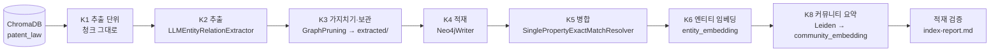

# 특허법 GraphRAG 지식그래프 인덱싱

확정된 그래프 스키마(`graphrag/schema/schema.json`)로 특허법 청크에서 엔티티와 관계를 뽑아 Neo4j에 지식그래프(KG, Knowledge Graph) 인덱스를 만듦. 다음 단계인 GraphRAG 검색 실습이 이 그래프를 씀.

## 1. 목표 및 주요 기능

- 목표: 벡터DB에 넣은 특허법 청크를 그대로 추출 단위로 써서, 스키마에 맞는 엔티티·관계 그래프와 검색용 벡터 인덱스를 Neo4j에 만듦
- 색인 방식: 전체 색인(full indexing). 실행할 때마다 그래프를 비우고 처음부터 다시 만듦. 증분 색인(바뀐 청크만 고치는 방식)은 하지 않음
- 주요 기능
  - 사전 검사: 벡터DB, 스키마, API Key, Neo4j(+GDS) 확인. 하나라도 안 되면 안내 후 종료
  - LLM 추출: `LLMEntityRelationExtractor`가 청크마다 엔티티(entity, 조문에서 뽑은 개념 노드)와 관계를 뽑음
  - 가지치기(pruning): `GraphPruning`이 스키마에 없는 노드·관계·속성을 지움
  - 추출 결과 보관: 청크별 JSON으로 저장해 LLM을 다시 부르지 않고 적재부터 다시 할 수 있음
  - 엔티티 병합(entity resolution): 같은 타입·같은 이름의 엔티티를 하나로 합침
  - 임베딩(embedding, 문장을 숫자 벡터로 바꾼 것): 엔티티 설명과 커뮤니티 요약을 Cohere로 임베딩해 벡터 인덱스를 만듦
  - 커뮤니티 요약: GDS(Graph Data Science) Leiden 알고리즘으로 서로 촘촘히 이어진 엔티티 묶음(커뮤니티)을 찾고 LLM으로 요약함(Global 검색용)
  - 적재 검증: 타입별 개수와 역량질문(competency question, 그래프가 답해야 하는 질문)별 패턴 경로 조회 결과를 `index-report.md`로 씀

## 2. 처리 흐름(K1 ~ K8)



| 단계 | 하는 일 | 사용 구성요소 |
|---|---|---|
| 사전 검사 | 벡터DB 컬렉션·청크 수, `schema.json` 불러오기, `GROQ_API_KEY`·`COHERE_API_KEY`, Neo4j 접속과 GDS 확인 | `graphrag/schema/common.py`의 `precheck`, `GraphSchema.from_file` |
| 그래프 비우기 | 기존 노드가 있으면 라벨별 개수를 보여 주고 확인(`y`)을 받은 뒤 노드·관계·인덱스를 모두 지움 | Cypher `DETACH DELETE` |
| K1 추출 단위 | 벡터DB 청크를 새로 자르지 않고 `chunk_index` 순으로 씀. 청크마다 `chunk_index`, `source`, 본문을 넘김. 청크 ID는 벡터DB 문서 ID와 같은 `{source}::{chunk_index:05d}` | `chromadb` |
| K2 추출 | 청크와 스키마를 넣어 청크마다 노드·관계를 뽑음. 청크 노드(`Chunk`)와 "엔티티 → 청크" 연결(`FROM_CHUNK`)을 함께 만듦. 실패한 청크는 건너뛰고 번호를 기록, Groq 호출 한도(429)는 1분 기다렸다가 다시 시도 | `LLMEntityRelationExtractor(create_lexical_graph=True)`, Groq `openai/gpt-oss-120b` |
| K3 가지치기·보관 | 스키마 밖 노드·관계·속성을 지우고(`additional_*` 모두 False), 정리된 결과를 청크별 JSON으로 저장. 지운 항목을 사유별·타입별로 셈 | `GraphPruning.run(graph, schema)` |
| K4 적재 | 보관한 결과(청크 노드, 엔티티 노드, 관계)를 Neo4j에 씀. 엔티티에는 `__Entity__` 라벨이 붙음 | `Neo4jWriter` |
| K5 병합 | `__Entity__` 노드만 대상으로 같은 타입·같은 `name`인 노드를 합침. 청크 노드와, 이름이 같아도 타입이 다른 노드는 합치지 않음 | `SinglePropertyExactMatchResolver` |
| K6 엔티티 임베딩 | 엔티티마다 `{타입}: {이름}. {설명 속성}` 문장을 만들어(설명 속성이 없으면 이름까지만) 임베딩 → `embedding` 속성, 벡터 인덱스 `entity_embedding`. 차원은 실제 임베딩 길이에서 읽음 | Cohere `embed-v4.0`, `upsert_vectors`, `create_vector_index` |
| K7 청크 정리 | 전체 색인이라 생략 | - |
| K8 커뮤니티 요약 | 엔티티 그래프를 무방향으로 투영해 Leiden(`randomSeed` 42)으로 묶음 → `Community` 노드와 `IN_COMMUNITY` 연결. 엔티티 2개 이상인 커뮤니티만 한국어 3문장 이내 요약 → `summary`, 요약 임베딩 → `embedding`, 벡터 인덱스 `community_embedding` | GDS `gds.leiden.stream`, Groq, Cohere |
| 적재 검증 | 노드·관계 타입별 개수, 역량질문별 패턴 경로(`schema-design.md` 5절) 조회 건수 → `index-report.md` | `verify_graph.py` |

### 그래프 모양

```text
(:Chunk {text, index, chunk_index, source})
(엔티티:Actor|Right|Invention|Procedure|Decision|Period|Penalty|Exclusion|Remedy :__Entity__ {name, embedding})
(엔티티)-[:FROM_CHUNK]->(:Chunk)                 # 어느 청크에서 나온 엔티티인지
(엔티티)-[스키마 관계 12종]->(엔티티)             # 예: (:Actor)-[:CAN_FILE]->(:Procedure)
(엔티티)-[:IN_COMMUNITY]->(:Community {id, size, summary, embedding})
```

## 3. 소스 코드 설명

| 파일 | 내용 |
|---|---|
| `index_graph.py` | 실행 스크립트. 단계마다 함수를 나누고 함수 위에 단계(K1 ~ K8) 주석을 닮 |
| `verify_graph.py` | 적재 검증(타입별 개수, 역량질문별 Cypher 조회)과 `index-report.md` 작성 |
| `requirements.txt` | 설치할 라이브러리 |
| `../schema/common.py` | 스키마 단계 공통 모듈을 그대로 가져다 씀(경로, 벡터DB 사전 검사, Groq LLM 생성 `make_llm`, JSON 저장) |

`index_graph.py`의 주요 함수:

| 함수 | 단계 | 설명 |
|---|---|---|
| `precheck()` | 사전 검사 | 벡터DB·스키마·API Key·Neo4j(GDS) 확인, 드라이버와 `GraphSchema` 반환 |
| `clear_graph()` | 그래프 비우기 | 기존 노드 수를 보여 주고 확인 후 노드·관계·인덱스 삭제 |
| `load_extraction_units()` | K1 | 벡터DB 청크를 `chunk_index` 순 추출 단위로 읽음 |
| `extract_chunk()` | K2 | 청크 하나 추출. 형식 오류 3회, 호출 한도(429) 1분씩 5회까지 재시도 |
| `prune_and_save()` | K3 | `GraphPruning` 후 `extracted/chunk-{chunk_index}.json` 저장 |
| `extract_and_prune()` | K2·K3 | 청크들을 동시에(기본 4개) 추출·정리. 실패 청크는 `extracted/failed-chunks.json`에 기록 |
| `summarize_pruning()` | K3 | 지워진 항목을 사유별·타입별로 세어 `pruning-stats.json` 저장 |
| `write_graph()` | K4 | `Neo4jWriter`로 청크·엔티티·관계 적재 |
| `merge_entities()` | K5 | `SinglePropertyExactMatchResolver`로 병합, 전후 엔티티 수 기록 |
| `embed_entities()` | K6 | 엔티티 설명 문장 임베딩, `entity_embedding` 인덱스 생성 |
| `detect_communities()` | K8 | GDS 투영 → Leiden → `Community` 노드·`IN_COMMUNITY` 연결 |
| `summarize_communities()` | K8 | 엔티티 2개 이상 커뮤니티 요약·임베딩, `community_embedding` 인덱스 생성 |

## 4. 가상환경 설정 및 패키지 설치

저장소 루트(`rag/`)에서 실행함. Python 3.11 이상.

### Windows(PowerShell)

```powershell
python -m venv .venv
.\.venv\Scripts\Activate.ps1
pip install -r graphrag/index/requirements.txt
```

### Windows(Git Bash)

```bash
python -m venv .venv
source .venv/Scripts/activate
pip install -r graphrag/index/requirements.txt
```

### Mac/Linux

```bash
python3 -m venv .venv
source .venv/bin/activate
pip install -r graphrag/index/requirements.txt
```

### 준비물

- 벡터DB: `vectordb/`의 `patent_law` 컬렉션(없으면 `vector/indexing/README.md`대로 인덱싱)
- 스키마: `graphrag/schema/schema.json`(없으면 `prompts/graphrag-schema.md` 수행)
- API Key: 저장소 루트 `.env`에 `GROQ_API_KEY`, `COHERE_API_KEY`
- Neo4j: `neo4j/README.md`대로 컨테이너 실행(`docker compose -f neo4j/compose.yml up -d`), 비밀번호는 `neo4j/.env`의 `NEO4J_PASSWORD`. 접속 주소가 다르면 환경변수 `NEO4J_URI`로 넘김

## 5. 실행 방법

1) 시범 실행: 청크 5건만 돌려 K1 ~ K8이 끝까지 도는지 확인

```bash
python graphrag/index/index_graph.py --limit 5
```

2) 전체 색인: 전체 청크로 그래프를 처음부터 다시 만듦

```bash
python graphrag/index/index_graph.py
```

- 기존 노드가 있으면 라벨별 개수를 보여 주고 `모두 지우고 처음부터 색인할까요? [y/N]`를 물음. `y`일 때만 지움
- 실행 로그는 화면과 `graphrag/index/index-run.log`에 함께 남음

3) 결과 확인: `graphrag/index/index-report.md`를 보거나 Neo4j Browser(http://localhost:7474)에서 조회

```cypher
// 역량질문 CQ09: 특허권자가 청구할 수 있는 구제 수단
MATCH (a:Actor)-[:CAN_CLAIM]->(m:Remedy) WHERE a.name CONTAINS '특허권자'
RETURN a.name, m.name
```

### 옵션

| 옵션 | 설명 |
|---|---|
| `--limit N` | 앞에서부터 N개 청크만 색인(시범 실행용) |
| `--yes` | 기존 그래프 삭제 확인을 묻지 않음. 지워도 되는지 확인한 뒤에만 씀 |
| `--from-extracted` | K2·K3를 건너뛰고 `extracted/`의 보관본으로 적재(K4)부터 다시 함. LLM을 부르지 않음 |
| `--resume` | `extracted/`에 이미 있는 청크는 다시 추출하지 않음(중단된 실행, 실패 청크만 다시 추출) |
| `--concurrency N` | 동시에 보낼 LLM 요청 수(기본 4). Groq 호출 한도에 자주 걸리면 줄임 |
| `--skip-communities` | K8 커뮤니티 요약을 건너뜀 |

## 6. 출력파일

| 파일 | 내용 |
|---|---|
| `extracted/chunk-{chunk_index}.json` | 청크별 가지치기 후 그래프(`graph`), 추출 원본·정리 후 개수, 지워진 항목 목록. 적재부터 다시 할 때 씀 |
| `extracted/failed-chunks.json` | 다시 시도해도 실패한 청크 번호와 오류 종류 |
| `pruning-stats.json` | 지워진 항목을 종류(노드·관계·속성)별, 사유별, 타입별, 청크별로 센 집계 |
| `index-report.md` | 단계별 건수, 실패 청크, 지워진 항목, 병합 전후 수, 노드·관계 타입별 개수, 벡터 인덱스, 역량질문별 조회 건수, 남은 한계 |
| `index-run.log` | 마지막 실행 로그 |
| Neo4j(`bolt://localhost:7687`) | 그래프와 벡터 인덱스 `entity_embedding`(엔티티), `community_embedding`(커뮤니티 요약) |

## 7. 참고

- 추출 프롬프트는 neo4j-graphrag 기본값을 씀(스키마 채우기 시험과 같은 조건). 스키마는 `schema.json`을 그대로 불러 쓰고 색인 중에 고치지 않음
- 추출 LLM은 temperature 0에서도 실행마다 결과가 조금씩 달라 다시 색인하면 개수가 달라질 수 있음
- 검색 쪽에서 Cohere로 질문을 임베딩할 때는 `input_type="search_query"`를 씀(색인은 `search_document`)
- 벡터DB(`vectordb/`)는 읽기만 하지만 chromadb가 파일을 갱신해 git 변경으로 잡힐 수 있음. 이 변경은 커밋하지 않고 `git restore vectordb/`로 되돌림
