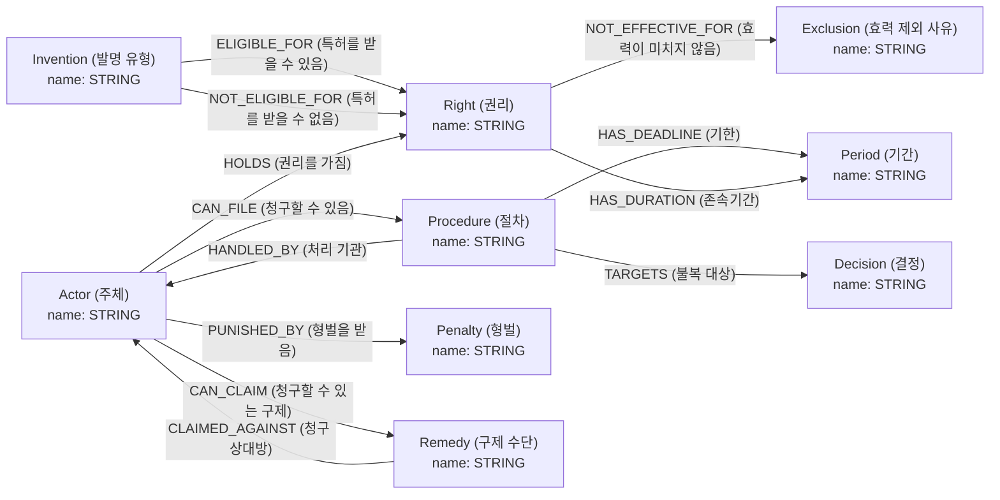

# 특허법 GraphRAG 스키마 설계서

- 작성일: 2026-10-26
- 스키마 파일: `schema.json` (neo4j-graphrag `GraphSchema.from_file()`로 그대로 불러옴. 라이브러리가 OS 기본 인코딩으로 읽으므로 Windows(cp949)에서도 읽히도록 한글을 유니코드 이스케이프로 저장함)
- 근거: 확정 역량질문 9개, 스키마 초안 2회차(work/schema-draft-r2.reviewed.json), 채우기 시험 5회차

## 1. 용어

- 그래프 스키마(graph schema): 지식 그래프에 담을 노드 타입·관계 타입·패턴의 약속. LLM이 문서에서 개체를 뽑을 때 기준이 됨
- 노드 타입(node type): 그래프의 점(개체) 종류. 예: Actor(주체)
- 관계 타입(relationship type): 점을 잇는 선의 종류. 예: CAN_FILE(청구할 수 있음)
- 패턴(pattern): `시작 노드 타입 -관계 타입-> 끝 노드 타입`. 어떤 관계가 어떤 노드 사이에만 올 수 있는지 정함
- 역량질문(competency question): 그래프가 답할 수 있어야 하는 질문 목록. 스키마 범위와 검증 기준이 됨
- 채우기 시험(fill test): 스키마대로 실제 청크에서 추출해 사람이 확정한 기대 결과와 비교하는 시험

## 2. 스키마 그림



- 같은 내용의 mermaid 원본: `schema-design.mmd`
- 스키마 밖 타입·관계·패턴은 모두 허용하지 않음(`additional_node_types`·`additional_relationship_types`·`additional_patterns` = False)

## 3. 노드 타입 (9개)

| 노드 타입 | 속성 | 추출 기준 설명 |
|---|---|---|
| Actor (주체) | `name`(STRING, 필수): 조문 원문의 주체 표현 그대로. 조사(은·는·이·가·에게)와 괄호 속 한자는 뺌. 예: '특허권자', '특허거절결정을 받은 자' | 특허법 조문이 권리·의무·권한을 정한 주체 유형(사람·법인·행정기관). 예: 특허권자, 전용실시권자, 누구든지, 특허거절결정 또는 특허권의 존속기간의 연장등록거절결정을 받은 자, 특허권 또는 전용실시권을 침해한 자, 특허심판원. [뽑지 않음] 전자문서·서류 제출·송달·고유번호·열람 업무 문장의 주체(예: 특허에 관한 절차를 밟는 자, 지식재산처장·특허심판원장이 서류를 받는 문장), '~할 수 없다'로 정한 주체. [공통] 아래 패턴의 관계로 다른 노드와 이어질 때만 뽑음. 관계 없이 혼자 남는 노드는 출력하지 않음. [이름 공통 규칙] 조문 원문 표현 그대로 쓰되 조사(은·는·이·가·에게)와 괄호 속 한자·부연 설명(예: (「약사법」에 따른 … 포함한다))은 뺌. '또는'으로 묶인 표현은 나누지 않고 하나로 씀(형벌만 예외). |
| Right (권리) | `name`(STRING, 필수): 조문 원문의 권리 명칭 그대로. '특허를 받을 수 있다/없다'의 대상은 '특허'로 씀 | 특허법이 정한 권리 또는 특허 그 자체. 예: 특허(받을 수 있다/없다의 대상), 특허권, 전용실시권, 특허를 받을 수 있는 권리. 권리 이름은 줄이지 않음('특허를 받을 수 있는 권리'를 '특허'로 쓰지 않음). [뽑지 않음] '특허권 또는 전용실시권을 침해한 자'처럼 다른 노드 이름 안에만 나오는 권리. [공통] 아래 패턴의 관계로 다른 노드와 이어질 때만 뽑음. 관계 없이 혼자 남는 노드는 출력하지 않음. [이름 공통 규칙] 조문 원문 표현 그대로 쓰되 조사(은·는·이·가·에게)와 괄호 속 한자·부연 설명(예: (「약사법」에 따른 … 포함한다))은 뺌. '또는'으로 묶인 표현은 나누지 않고 하나로 씀(형벌만 예외). |
| Invention (발명 유형) | `name`(STRING, 필수): 조문 원문의 발명 유형 명사구 그대로(‘~한 발명’으로 끝남). 괄호 속 한자는 뺌 | 특허를 받을 수 있는지가 갈리는 발명의 유형. 특허요건(제29조)과 특허를 받을 수 없는 발명(제32조) 문장에서만 뽑음. 예: 산업상 이용할 수 있는 발명, 특허출원 전에 국내 또는 국외에서 공지되었거나 공연히 실시된 발명, 그 발명이 속하는 기술분야에서 통상의 지식을 가진 사람이 쉽게 발명할 수 있는 발명. [뽑지 않음] 개별 발명 이름, '특허발명'·'특허발명의 실시' 같은 일반어. [공통] 아래 패턴의 관계로 다른 노드와 이어질 때만 뽑음. 관계 없이 혼자 남는 노드는 출력하지 않음. [이름 공통 규칙] 조문 원문 표현 그대로 쓰되 조사(은·는·이·가·에게)와 괄호 속 한자·부연 설명(예: (「약사법」에 따른 … 포함한다))은 뺌. '또는'으로 묶인 표현은 나누지 않고 하나로 씀(형벌만 예외). |
| Procedure (절차) | `name`(STRING, 필수): 조문 제목이나 원문에 나온 절차 명칭 그대로. 예: '출원심사의 청구', '특허거절결정에 대한 심판' | 주체가 청구·신청할 수 있다고 조문이 정한 특허 절차로, 심사 청구와 불복·분쟁 절차만 담음. 예: 출원심사의 청구, 특허거절결정 등에 대한 심판, 특허무효심판. 조문 제목에 절차 이름이 있으면 그 이름을 씀. [뽑지 않음] 특허출원·보정·분할출원 같은 출원 절차, 전자문서 이용신고·서류 제출·송달·고유번호·열람 같은 행정 사무, 기관의 소관 업무를 나열하거나 '~에 관한 절차 외의 절차'처럼 언급만 하는 문장의 절차명. [공통] 아래 패턴의 관계로 다른 노드와 이어질 때만 뽑음. 관계 없이 혼자 남는 노드는 출력하지 않음. [이름 공통 규칙] 조문 원문 표현 그대로 쓰되 조사(은·는·이·가·에게)와 괄호 속 한자·부연 설명(예: (「약사법」에 따른 … 포함한다))은 뺌. '또는'으로 묶인 표현은 나누지 않고 하나로 씀(형벌만 예외). |
| Decision (결정) | `name`(STRING, 필수): 조문 원문의 결정 명칭 그대로 | 지식재산처장·심사관·특허심판원이 내리는 처분·결정으로 불복 절차의 대상(TARGETS)이 되는 것. 예: 특허거절결정, 특허권의 존속기간의 연장등록거절결정, 특허취소결정. 결정을 '받은 자'는 Actor로 뽑음. [공통] 아래 패턴의 관계로 다른 노드와 이어질 때만 뽑음. 관계 없이 혼자 남는 노드는 출력하지 않음. [이름 공통 규칙] 조문 원문 표현 그대로 쓰되 조사(은·는·이·가·에게)와 괄호 속 한자·부연 설명(예: (「약사법」에 따른 … 포함한다))은 뺌. '또는'으로 묶인 표현은 나누지 않고 하나로 씀(형벌만 예외). |
| Period (기간) | `name`(STRING, 필수): 조문 원문의 기간 표현 그대로(기점과 끝을 모두 포함). 실제 날짜로 바꾸지 않음 | Procedure의 기한(HAS_DEADLINE) 또는 Right의 원칙적 존속기간(HAS_DURATION)을 나타내는 조문 표현. 예: 특허출원일부터 3년 이내, 그 결정등본을 송달받은 날부터 3개월 이내, 특허권을 설정등록한 날부터 특허출원일 후 20년이 되는 날까지. [뽑지 않음] 존속기간의 예외적 기산점·연장 기간, 특허출원·송달·열람 등 범위 밖 절차의 기간. [공통] 아래 패턴의 관계로 다른 노드와 이어질 때만 뽑음. 관계 없이 혼자 남는 노드는 출력하지 않음. [이름 공통 규칙] 조문 원문 표현 그대로 쓰되 조사(은·는·이·가·에게)와 괄호 속 한자·부연 설명(예: (「약사법」에 따른 … 포함한다))은 뺌. '또는'으로 묶인 표현은 나누지 않고 하나로 씀(형벌만 예외). |
| Penalty (형벌) | `name`(STRING, 필수): 조문 원문의 형벌 표현 그대로. 예: '7년 이하의 징역', '1억원 이하의 벌금' | 범죄에 대한 형벌. 예: 7년 이하의 징역, 1억원 이하의 벌금. 징역과 벌금이 '또는'으로 함께 나오면 각각 따로 뽑음. [공통] 아래 패턴의 관계로 다른 노드와 이어질 때만 뽑음. 관계 없이 혼자 남는 노드는 출력하지 않음. |
| Exclusion (효력 제외 사유) | `name`(STRING, 필수): 조문 각 호의 표현 그대로(호 번호는 뺌) | 특허권의 효력이 미치지 아니하는 경우(제96조 등). 예: 연구 또는 시험을 하기 위한 특허발명의 실시, 국내를 통과하는데 불과한 선박ㆍ항공기ㆍ차량 또는 이에 사용되는 기계ㆍ기구ㆍ장치, 그 밖의 물건, 특허출원을 한 때부터 국내에 있는 물건. 호 번호와 괄호 속 부연 설명은 뺌. [공통] 아래 패턴의 관계로 다른 노드와 이어질 때만 뽑음. 관계 없이 혼자 남는 노드는 출력하지 않음. [이름 공통 규칙] 조문 원문 표현 그대로 쓰되 조사(은·는·이·가·에게)와 괄호 속 한자·부연 설명(예: (「약사법」에 따른 … 포함한다))은 뺌. '또는'으로 묶인 표현은 나누지 않고 하나로 씀(형벌만 예외). |
| Remedy (구제 수단) | `name`(STRING, 필수): 조문 원문의 청구 내용 표현 그대로. 예: '침해의 금지 또는 예방' | 권리를 침해당한 자가 침해한 자에게 청구할 수 있는 민사 구제. 예: 침해의 금지 또는 예방, 침해행위를 조성한 물건의 폐기, 손해의 배상. 형벌(Penalty)은 넣지 않음. [공통] 아래 패턴의 관계로 다른 노드와 이어질 때만 뽑음. 관계 없이 혼자 남는 노드는 출력하지 않음. [이름 공통 규칙] 조문 원문 표현 그대로 쓰되 조사(은·는·이·가·에게)와 괄호 속 한자·부연 설명(예: (「약사법」에 따른 … 포함한다))은 뺌. '또는'으로 묶인 표현은 나누지 않고 하나로 씀(형벌만 예외). |

## 4. 관계 타입 (12개)

| 관계 타입 | 패턴 | 추출 기준 설명 |
|---|---|---|
| ELIGIBLE_FOR (특허를 받을 수 있음) | Invention → Right | Invention → Right('특허'). '~한 발명은 특허를 받을 수 있다'일 때 |
| NOT_ELIGIBLE_FOR (특허를 받을 수 없음) | Invention → Right | Invention → Right('특허'). '~한 발명은 특허를 받을 수 없다', '~를 제외하고는 특허를 받을 수 있다'의 제외 대상일 때 |
| CAN_FILE (청구할 수 있음) | Actor → Procedure | Actor → Procedure. 주체가 그 절차를 청구·신청할 수 있다고 정한 문장. 예: 누구든지 → 출원심사의 청구 |
| HANDLED_BY (처리 기관) | Procedure → Actor | Procedure → Actor. 절차를 받거나 심리하는 기관. '~에게 청구', '~을 관장하게 하기 위하여 ~을 둔다'일 때. 기관이 어떤 종류의 절차(예: 심판)를 관장한다고 정하면, 같은 청크에서 CAN_FILE로 뽑은 그 종류의 개별 절차(예: 특허거절결정 등에 대한 심판)를 그 기관에 이음. 예: 특허거절결정 등에 대한 심판 → 특허심판원, 출원심사의 청구 → 지식재산처장 |
| TARGETS (불복 대상) | Procedure → Decision | Procedure → Decision. 불복 절차의 대상 처분. 예: 특허거절결정에 대한 심판 → 특허거절결정 |
| HAS_DEADLINE (기한) | Procedure → Period | Procedure → Period. 절차를 할 수 있는 기한. '~ 이내에 ~를 청구할 수 있다'일 때 |
| HAS_DURATION (존속기간) | Right → Period | Right → Period. 권리의 원칙적 존속기간. '~의 존속기간은 ~까지로 한다'일 때. 예외적 기산점이나 연장은 잇지 않음 |
| NOT_EFFECTIVE_FOR (효력이 미치지 않음) | Right → Exclusion | Right → Exclusion. '특허권의 효력은 다음 각 호의 어느 하나에 해당하는 사항에는 미치지 아니한다'의 각 호 |
| HOLDS (권리를 가짐) | Actor → Right | Actor → Right. 조문이 '~ 권리를 가진다', '~를 공유한다'처럼 권리의 귀속을 직접 정한 문장에서만 씀. 예: 발명을 한 사람 → 특허를 받을 수 있는 권리. '특허권자', '전용실시권자'처럼 이름에 권리가 들어 있다는 이유만으로 잇지 않음 |
| CAN_CLAIM (청구할 수 있는 구제) | Actor → Remedy | Actor → Remedy. 권리자가 청구할 수 있는 구제. 예: 특허권자 → 침해의 금지 또는 예방 |
| CLAIMED_AGAINST (청구 상대방) | Remedy → Actor | Remedy → Actor. 구제 청구의 상대방. 예: 침해의 금지 또는 예방 → 권리를 침해한 자 |
| PUNISHED_BY (형벌을 받음) | Actor → Penalty | Actor → Penalty. 그 행위를 한 자가 받는 형벌. 예: 특허권 또는 전용실시권을 침해한 자 → 7년 이하의 징역 |

## 5. 역량질문별 패턴 경로

| ID | 역량질문 | 패턴 경로 | 시험에서 이어짐 | 설명 |
|---|---|---|---|---|
| CQ01 | 특허를 받을 수 있는 발명의 요건은 무엇인가? | `Invention -ELIGIBLE_FOR-> Right ; Invention -NOT_ELIGIBLE_FOR-> Right` | O (3/3) | 특허를 받을 수 있는 발명 유형과 제외되는 발명 유형을 함께 보면 요건(산업상 이용가능성, 공지·간행물 게재가 아닐 것, 쉽게 발명할 수 없을 것)이 나옴 |
| CQ02 | 특허를 받을 수 없는 발명은 어떤 것인가? | `Invention -NOT_ELIGIBLE_FOR-> Right` | O (3/3) | '특허'에 NOT_ELIGIBLE_FOR로 이어진 발명 유형이 답 |
| CQ03 | 특허출원심사의 청구는 누가 할 수 있는가? | `Actor -CAN_FILE-> Procedure` | O (3/3) | '출원심사의 청구'에 CAN_FILE로 이어진 주체(누구든지)가 답 |
| CQ04 | 특허거절결정에 불복하려면 누구에게 어떤 심판을 청구하는가? | `Actor -CAN_FILE-> Procedure -TARGETS-> Decision ; Procedure -HANDLED_BY-> Actor` | X (1/3) | '특허거절결정'을 TARGETS로 가진 절차가 '어떤 심판', 그 절차의 HANDLED_BY 기관이 '누구에게' |
| CQ05 | 특허출원심사의 청구는 언제까지 할 수 있는가? | `Procedure -HAS_DEADLINE-> Period` | O (3/3) | '출원심사의 청구'의 기한이 답 |
| CQ06 | 특허권의 존속기간은 언제부터 언제까지인가? | `Right -HAS_DURATION-> Period` | O (3/3) | '특허권'의 존속기간 표현이 답 |
| CQ07 | 특허권을 침해한 자는 어떤 형벌을 받는가? | `Actor -PUNISHED_BY-> Penalty` | O (3/3) | '특허권 또는 전용실시권을 침해한 자'의 형벌이 답 |
| CQ08 | 특허권의 효력이 미치지 아니하는 경우는 무엇인가? | `Right -NOT_EFFECTIVE_FOR-> Exclusion` | O (3/3) | '특허권'에 이어진 Exclusion이 답 |
| CQ09 | 특허권을 침해당한 특허권자는 어떤 청구를 할 수 있는가? | `Actor -CAN_CLAIM-> Remedy` | O (3/3) | '특허권자'가 CAN_CLAIM으로 이어진 구제 수단이 답(상대방은 CLAIMED_AGAINST) |

## 6. 채우기 시험 결과(최종 판정)

- 회차: 5회차, 비교 A: 2회차 스키마 + 기본 추출 프롬프트, 3회 반복
- 추출: `LLMEntityRelationExtractor`(openai/gpt-oss-120b, 추출 프롬프트: 라이브러리 기본값(ERExtractionTemplate)) → `GraphPruning`
- 재현율(기대 항목 중 뽑힌 비율): 0.870 (실행별 0.817 ~ 0.927) — 기준 0.8 이상 **충족**
- 지어냄 비율(뽑힌 항목 중 기대에 없는 비율): 0.294 (실행별 0.269 ~ 0.309) — 기준 0.1 이하 **미달**
- 역량질문 답 가능: 8/9(3회 중 2회 이상 이어짐) — 기준 모두 답 가능 **미달**(CQ04)
- 채점 기준: 이 회차는 7회차 이전의 기대 결과(work/fill-test-expected.v1.json)로 채점함. 현재 기대 결과(chunk 73에 제88조② 기산점 추가)로 저장 결과를 다시 계산하면 재현율 0.873, 지어냄 비율 0.274
- 회차별 전체 결과와 원인 추정: `fill-test-report.md`

## 7. 한계와 권고

- 지어냄 비율 기준(0.1 이하) 미달: 최종 스키마의 3회 평균 지어냄 비율 0.294. 프롬프트의 완료조건 중 '기준을 넘은 회차가 있음'은 충족하지 못했고, 사용자 결정으로 가장 나은 스키마를 최종안으로 확정함
- 남은 지어냄의 출처: 역량질문과 무관한 행정 조문(전자문서 이용신고 등)에서 뽑힌 절차·기관, 관계 없이 혼자 남은 주체(고립 노드), 존속기간 연장 같은 범위 밖 기간, '~한 경우' 조건문 형태의 이름 변형. 스키마 설명의 [뽑지 않음] 규칙을 추출 LLM이 잘 따르지 않음
- 권고(인덱싱 단계): 추출 뒤 엔터티 관계가 하나도 없는 고립 노드를 지우는 후처리를 둘 것. 저장된 추출 결과로 계산하면 지어냄 비율이 0.274에서 0.206으로 내려가고 재현율은 그대로임(현재 기대 결과 기준)
- 권고(인덱싱 단계): 0.1 이하가 필요하면 추출 전에 청크가 역량질문 범위인지 판별하는 단계를 검토할 것
- 실행 변동: 추출 LLM은 temperature 0에서도 결과가 실행마다 달라, 같은 설정에서 청크 하나가 11건 모두 맞음과 0건 사이를 오감. 채우기 시험은 3회 반복 평균으로 판정함
- CQ04(거절결정 불복 → 심판 → 특허심판원)는 3회 중 1회만 이어짐. 불복 주체 이름이 줄거나 특허심판원으로 가는 HANDLED_BY가 빠지는 경우가 있음
- 이름 규칙 불일치: 최종 스키마의 이름 규칙은 '또는'으로 묶인 표현을 나누지 않지만, 확정 기대 결과는 '발명을 한 사람'과 '그 승계인'을 나눔(4·7회차에서 고친 규칙은 최종안에 넣지 않음)
- 기대 결과 범위 불일치: 기대 결과 chunk 73에는 제88조② 존속기간 기산점이 있지만(7회차 때 추가), 최종 스키마 설명은 존속기간의 예외적 기산점을 뽑지 않도록 되어 있음
- 범위: 시험용 청크 10건(관련 8, 무관 2)으로만 검증함. 역량질문 9개 범위 밖의 조문(국제출원, 재심 절차 세부 등)은 담지 않음

## 8. 인덱싱 단계에서 쓰는 법

```python
from neo4j_graphrag.components.schema import GraphSchema
from neo4j_graphrag.experimental.pipeline.kg_builder import SimpleKGPipeline

schema = GraphSchema.from_file("graphrag/schema/schema.json")
kg_builder = SimpleKGPipeline(llm=llm, driver=driver, embedder=embedder, schema=schema)
# 추출 프롬프트는 라이브러리 기본값(채우기 시험과 같은 조건)
```
