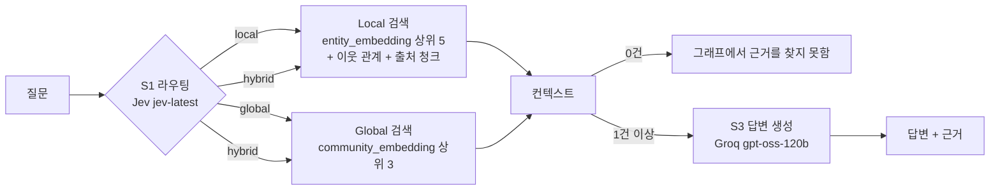

# 특허법 GraphRAG 검색 예제

`graphrag/index/`로 만든 특허법 지식그래프(Neo4j)에서 질문에 맞는 검색 방식을 골라 근거를 찾고 답하는 예제. 질문마다 같은 3단계를 같은 순서로 도는 고정 워크플로우(fixed workflow)이며, 에이전트가 스스로 다음 행동을 정하는 방식이 아님.

## 1. 목표 및 주요 기능

- 목표: 질문 성격에 따라 Local, Global, Hybrid 중 하나를 골라 그래프에서 근거를 찾고, 근거만으로 한국어 답을 만듦
- 주요 기능
  - S1 라우팅(routing, 질문을 알맞은 검색 방식으로 보내는 일): TypeSafe Jev가 세 검색 방식 중 하나를 고르고 확신도(confidence)를 함께 줌
  - S2 검색: 벡터 인덱스(vector index, 임베딩 유사도로 가까운 노드를 찾는 색인)로 엔티티나 커뮤니티 요약을 찾음
  - S3 답변 생성: 검색 결과(컨텍스트)에 있는 내용만으로 답하고 끝에 근거(조문 번호, 엔티티 이름)를 붙임
  - 시험: 역량질문 9개 + Global형 2개 + Hybrid형 2개로 라우팅 일치와 답변을 기록함
- 질문 1건당 모델 호출: S1 Jev 1회, S3 Groq 1회(질문·근거 임베딩용 Cohere 호출은 별도)
- 그래프는 읽기만 함(쓰기·삭제 없음)

## 2. 처리 흐름(S1 ~ S3)



| 단계 | 하는 일 | 사용 구성요소 |
|---|---|---|
| 사전 검사 | Neo4j 접속, 벡터 인덱스 `entity_embedding`·`community_embedding`, `GROQ_API_KEY`·`COHERE_API_KEY`·`JEV_API_KEY` 확인. 안 되면 안내 후 종료 | neo4j 드라이버 |
| S1 라우팅 | 질문을 `state`에, 세 검색 방식 설명을 `Choice` 질문의 `criteria`에 넣어 Jev를 1회 호출. `choice`와 `confidence`를 기록. 호출이 실패하면 `hybrid` | `typesafe_sdk.TypeSafeClient.system_one`, `Choice` |
| S2 검색 | 고른 방식대로 Local, Global 또는 둘 다 실행. 결과가 0건이면 S3으로 넘기지 않고 "그래프에서 근거를 찾지 못함" | `VectorCypherRetriever`, `VectorRetriever` |
| S3 답변 | 컨텍스트와 질문으로 Groq를 1회 호출. 컨텍스트 밖 내용은 쓰지 않고 답 끝에 `근거:` 줄을 붙임 | `OpenAILLM`(Groq OpenAI 호환 엔드포인트) |

## 3. 검색 방식 3가지

| 방식 | 언제 쓰나 | 무엇을 근거로 쓰나 |
|---|---|---|
| Local | 특정 개념, 요건, 기간을 묻는 질문 | 질문과 가까운 엔티티 상위 5개, 그 엔티티의 1단계 이웃 관계(최대 20개), 출처 청크 본문(엔티티당 최대 2개, 이웃 엔티티가 많이 함께 나온 청크 먼저) |
| Global | 법 전체의 주제나 흐름을 묻는 질문 | 질문과 가까운 커뮤니티(서로 촘촘히 이어진 엔티티 묶음) 요약 상위 3개 |
| Hybrid | 특정 대상을 전체 맥락 속에서 묻는 질문 | Local 결과와 Global 결과를 이어 붙임 |

Jev에 넘기는 선택지 설명(`criteria`)은 위 세 방식 설명을 그대로 씀(`graph_search.py`의 `ROUTE_CRITERIA`).

## 4. 소스 코드 설명

| 파일 | 내용 |
|---|---|
| `graph_search.py` | 검색 프로그램. S1·S2·S3을 함수로 나누고 함수 위에 단계 주석을 닮. 한 질문을 바로 실행하는 CLI 포함 |
| `make_test_questions.py` | 시험 질문 초안 작성. 역량질문 9개에 LLM이 Global형 2개·Hybrid형 2개를 더 써서 `test-questions.md`(상태: 검토 중)로 저장 |
| `run_tests.py` | 확정된 시험 질문을 모두 실행해 `test-report.md`와 `test-run.log`를 씀 |
| `../index/index_graph.py` | 접속 설정, 인덱스 이름, 임베딩 모델 이름을 가져다 씀 |
| `../schema/common.py` | Groq LLM 생성(`make_llm`), 확정 파일 읽기, 콘솔 UTF-8 설정을 가져다 씀 |

`graph_search.py`의 주요 함수:

| 함수 | 단계 | 설명 |
|---|---|---|
| `precheck()` | 사전 검사 | Neo4j·벡터 인덱스·API Key 확인, 드라이버 반환 |
| `GraphSearch.route()` | S1 | Jev 1회 호출(SDK 재시도는 꺼서 1회를 지킴). 실패하면 `hybrid` |
| `GraphSearch.search_local()` | S2 | `VectorCypherRetriever` + `LOCAL_RETRIEVAL_QUERY`로 엔티티·이웃 관계·출처 청크 |
| `GraphSearch.search_global()` | S2 | `VectorRetriever`로 커뮤니티 요약 |
| `GraphSearch.retrieve()` | S2 | 고른 방식대로 Local/Global 실행 |
| `build_context()` | S2 → S3 | 검색 결과를 컨텍스트 문자열로 정리(같은 청크는 한 번만) |
| `GraphSearch.generate()` | S3 | Groq 1회 호출로 답변 생성 |
| `GraphSearch.ask()` | S1 ~ S3 | 한 질문을 끝까지 처리해 `SearchResult` 반환 |

## 5. 가상환경 설정 및 패키지 설치

저장소 루트(`rag/`)에서 실행함. Python 3.11 이상.

### Windows(PowerShell)

```powershell
python -m venv .venv
.\.venv\Scripts\Activate.ps1
pip install -r graphrag/search/requirements.txt
```

### Windows(Git Bash)

```bash
python -m venv .venv
source .venv/Scripts/activate
pip install -r graphrag/search/requirements.txt
```

### Mac/Linux

```bash
python3 -m venv .venv
source .venv/bin/activate
pip install -r graphrag/search/requirements.txt
```

### 준비물

- 그래프: `graphrag/index/README.md`대로 색인한 Neo4j(`bolt://localhost:7687`), 비밀번호는 `neo4j/.env`의 `NEO4J_PASSWORD`
- API Key: 저장소 루트 `.env`에 `GROQ_API_KEY`, `COHERE_API_KEY`, `JEV_API_KEY`
  - Jev 키는 SDK 기본 변수 이름(`TYPESAFE_API_KEY`)이 아닌 `JEV_API_KEY`를 읽어 클라이언트에 직접 넘김

## 6. 실행 방법

1) 질문 하나 실행

```bash
python graphrag/search/graph_search.py "특허권의 존속기간은 언제부터 언제까지인가?"
```

출력: 질문, 선택된 검색 방식과 확신도, 답변

2) 검색된 컨텍스트까지 보기

```bash
python graphrag/search/graph_search.py "특허심판원은 특허법의 분쟁 해결 흐름 전체 속에서 어떤 역할을 맡는가?" --verbose
```

3) 시험

```bash
python graphrag/search/make_test_questions.py
```

- `test-questions.md`를 검토해 질문과 기대 검색 방식을 고친 뒤 `상태: 확정`으로 바꿈(확정 전에는 시험하지 않음)

```bash
python graphrag/search/run_tests.py
```

### 옵션(`graph_search.py`)

| 옵션 | 설명 |
|---|---|
| `--verbose` | 검색된 컨텍스트(엔티티, 관계, 출처 청크, 커뮤니티 요약)도 보여 줌 |
| `--route local\|global\|hybrid` | S1을 건너뛰고 검색 방식을 직접 지정(같은 질문으로 세 방식을 비교하는 실습용, Jev 호출 없음) |

## 7. 출력파일

| 파일 | 내용 |
|---|---|
| `test-questions.md` | 확정된 시험 질문과 기대 검색 방식 |
| `test-report.md` | 질문별 선택 방식·확신도·일치 여부·근거 수·답변, 라우팅 일치 수, 방식별 실행 횟수 |
| `test-run.log` | 마지막 시험 실행 로그 |
